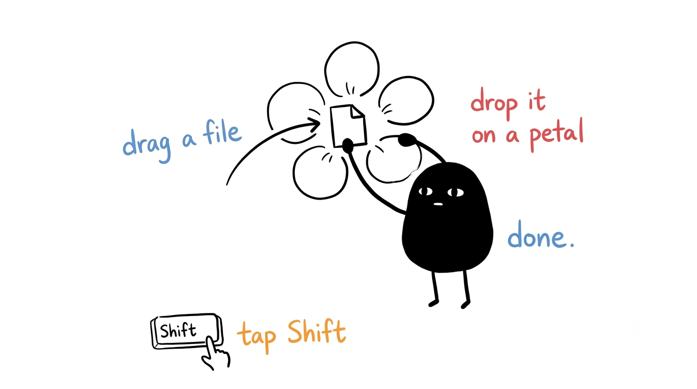
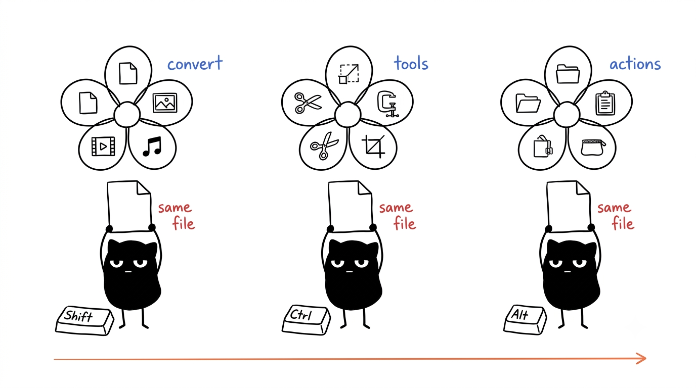
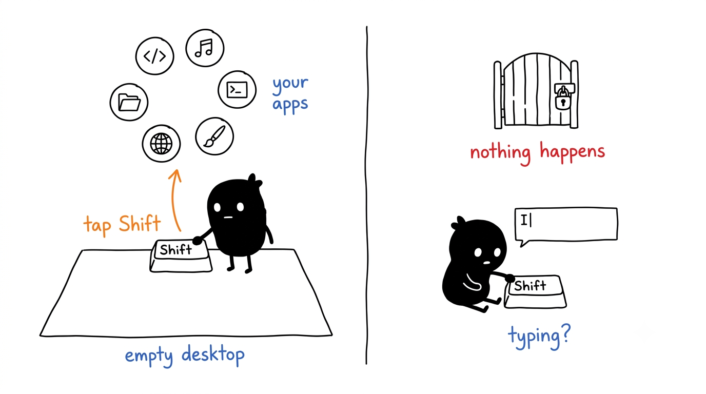
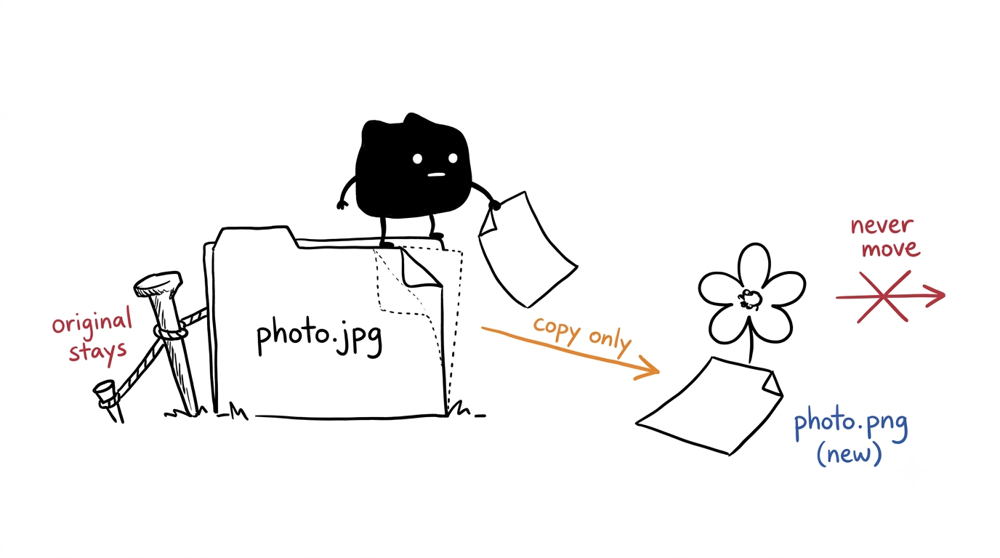
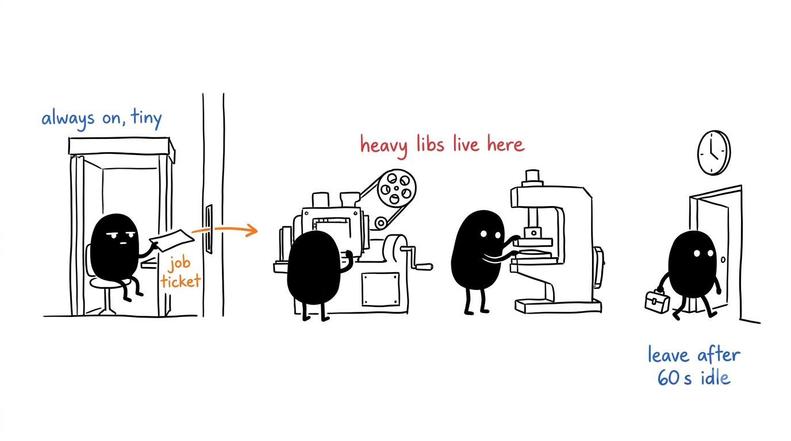
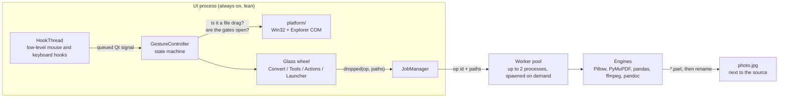

<div align="center">

# DragShift

Drag a file, tap a key, and drop it on a glass wheel to convert it.<br>
A free, open-source Windows take on Tangerine for Mac. Everything runs on your own machine.

[![Python 3.12][badge-python]][link-python]
[![PySide6][badge-qt]][link-qt]
[![uv][badge-uv]][link-uv]
[![Windows 10 | 11][badge-windows]][link-windows]
[![License: AGPL-3.0][badge-license]](LICENSE)



</div>

## About

Converting a file on Windows usually means opening an app or a website, uploading the file, picking a format, downloading the result and moving it back where it belongs. Online converters also send private files to servers you know nothing about.

Tangerine for Mac solved this with a gesture. You start dragging a file, tap a modifier key, and a radial wheel opens around the cursor. You drop the file on a petal, and the new file appears next to the original. DragShift brings that gesture to Windows as a small background app. It also adds **Quick Launch**: tap Shift or Ctrl on an empty desktop to open a wheel of your favourite apps or websites.

DragShift is a clean-room re-implementation. It copies no code or assets from Tangerine.

## How it works



| You do this | You get |
|---|---|
| Drag a file and tap **Shift** | The **Convert** wheel: PNG, JPG, WEBP, PDF, DOCX, MP4, MP3, CSV, ZIP… |
| Drag a file and tap **Ctrl** | The **Tools** wheel: compress with size presets, crop, add a background, resize, rotate… |
| Drag a file and tap **Alt** | The **Actions** wheel: copy path, open a terminal here, copy or move to a pinned folder, zip… |
| Tap **Shift** on an empty desktop | **Quick Launch**: up to 8 of your apps |
| Tap **Ctrl** on an empty desktop | **Quick Launch**: up to 8 of your websites |

While a wheel is open you can tap a different key to swap wheels. Press **Esc**, or drop anywhere outside a petal, and nothing happens. The new file is written next to the source, as `photo.jpg` for a convert or `clip Compressed.mp4` for a tool, and an existing file is never overwritten: a clash becomes `photo (2).jpg`.

When a job finishes, a small toast offers **Open**, **Show** and **Undo**. Undo sends the new file to the Recycle Bin. The last 20 jobs are under **History** in the tray menu, and you can undo them from there too. Petals you use often move to the front of the wheel.

### What it can do

These are the petals each wheel offers. A target in the same format as the file is hidden, so a PNG has no "PNG" petal.

**Convert (Shift)**

| Input | Targets |
|---|---|
| **Image**: jpg png webp heic avif tiff bmp gif ico, svg (input only) | JPG PNG WEBP HEIC AVIF PDF TIFF BMP ICO |
| **Several images** | Merge to PDF |
| **PDF** | DOCX PNG JPG TXT MD PPTX (one image per page, in a folder) |
| **Document**: docx md txt html epub odt rtf | DOCX MD TXT HTML EPUB ODT RTF |
| **Spreadsheet**: xlsx xls ods csv tsv | XLSX CSV TSV ODS |
| **Audio**: mp3 m4a wav flac ogg opus aiff wma aac | MP3 M4A WAV FLAC OGG OPUS AIFF |
| **Video**: mp4 mov mkv webm avi wmv m4v | MP4 MOV MKV WEBM AVI GIF MP3 |
| **Subtitle**: srt vtt ass ssa | SRT VTT ASS TXT |
| **Archive**: zip tar gz tgz rar 7z | Extract here, ZIP, TAR.GZ |
| **Folder** | ZIP |

**Tools (Ctrl)**

| Input | Tools |
|---|---|
| **Image** | Compress, Crop, Add BG, Resize (50 %, 1080p, 4K), Rotate and flip, Strip metadata |
| **PDF** | Compress, Merge, Split, Rotate, Strip metadata |
| **Video** | Compress, Mute, Extract audio, To GIF, Resize (720p, 1080p) |
| **Audio** | Compress, Bitrate (96 to 320 kbps), Normalize |

Hovering **Compress** opens a ring of size presets: **Email 25 MB**, **WhatsApp 16 MB**, **Discord 10 MB**, **Small** (half the size) and **Custom…**. DragShift encodes the file to fit under the size you picked, and tells you if it can't.

**Crop** and **Add BG** open a small glass editor first. Crop has free and fixed ratios (1:1, 16:9, 9:16, 4:3, 3:4) and exact width and height fields. Add BG puts the image on a gradient, a solid colour or another picture, with sliders for padding, corner radius and shadow.

**Actions (Alt)**: Copy path, Copy name, Terminal (opens Windows Terminal or PowerShell in that folder), Copy to and Move to one of up to four pinned folders, Zip, and Copy SHA-256. These also work on folders.

### Quick Launch



A **tap** is a key going down and up within 300 ms with nothing else pressed in between. Holding Shift to type a capital letter is not a tap. Before a Quick Launch wheel opens, every one of these checks must pass, or nothing happens:

- The desktop or an Explorer window is in front.
- No full-screen game, presentation or "busy" state is running.
- The focus is not in a text box, so renaming a file does not trigger it.
- Nothing is selected on the desktop or in that Explorer window.
- The app in front is not on your blocklist.
- Gestures are not paused.

Pick a slot with a click or the keys **1** to **8**. If single taps still trigger by accident, switch to double-tap under **Settings → Keys**.

## Getting started

### Requirements

- Windows 11, or Windows 10 22H2, on x64.
- [uv](https://docs.astral.sh/uv/getting-started/installation/). It installs Python 3.12 for you if you don't have it.

You don't need ffmpeg or pandoc. They come bundled with DragShift. If ffmpeg is already on your `PATH`, DragShift uses that one.

### Install

Open PowerShell and run:

```powershell
uv tool install git+https://github.com/RudraSomaiya/DragShift
```

This puts a `dragshift` command on your `PATH`. If PowerShell says it can't find it, run `uv tool update-shell` once and open a new window. The first install downloads about 350 MB of libraries (Qt, PyMuPDF, pandas, ffmpeg and pandoc) and takes about 1 GB on disk.

### Run

```powershell
dragshift --background    # starts in the background, with no console window
dragshift                 # or run it in this console, with logs; Ctrl+C quits
```

A DragShift icon appears in the system tray. Drag any file from the desktop or Explorer and tap **Shift**. Only one copy runs at a time, so starting it again does nothing.

To start DragShift every time you sign in, open **Settings → General** from the tray icon and tick **Start DragShift when I sign in**.

### Update and uninstall

```powershell
uv tool upgrade dragshift       # get the latest version
uv tool uninstall dragshift     # remove it
```

Before you uninstall, untick **Start DragShift when I sign in** and quit DragShift from the tray, or Windows will try to start a program that no longer exists. Your settings stay in `%APPDATA%\DragShift` until you delete that folder.

## Settings

Right-click the tray icon and choose **Settings…**. Every change applies at once.

| Tab | What you can change |
|---|---|
| **Keys** | Which key opens which wheel, single tap or double tap |
| **Wheels** | Pin petals to the front, or reset the usage counts that order them |
| **Launcher** | The 8 app slots and 8 site slots. Drop a file on a slot, or pick from your Start menu apps |
| **Appearance** | Light, dark or system theme, the accent colour, reduced motion |
| **Output** | Where new files go, JPEG and WebP quality, and the resolution of PDF pages turned into images |
| **General** | Start at sign-in, Quick Launch on or off, the blocklist, trimming memory when idle |

The tray menu also has **History**, **Pause gestures** and **Open log folder**.

DragShift keeps its files in three places:

| What | Where |
|---|---|
| Settings | `%APPDATA%\DragShift\config.json` |
| Site icons (fetched once per site) | `%APPDATA%\DragShift\icons\` |
| Logs (1 MB × 3, rotating) | `%LOCALAPPDATA%\DragShift\logs\dragshift.log` |

If `config.json` is ever broken, DragShift saves it as `config.bad.json` and starts with defaults, so a typo never stops the app. Every key and its default is listed in [PRD §10.1](docs/PRD.md#101-appdatadragshiftconfigjson-schema-v1).

## Command line

The same operations run without the wheel, which is handy for scripts:

```powershell
dragshift ops photo.png                          # list what the wheels would offer
dragshift convert photo.png --to jpg             # writes photo.jpg next to it
dragshift convert a.jpg b.jpg --to "merge to pdf"
dragshift tool tools.video.compress clip.mp4 --preset discord
```

Output paths are printed one per line. The exit code is `0` on success, `1` if the operation failed, and `2` for bad usage.

## Your files are safe



DragShift never changes, moves or deletes the file you drag:

- **Copy, never move.** When you hold Shift during a drag, Explorer treats the drop as a *move* and deletes the source if the target agrees. DragShift's wheel only ever reports a *copy*, and over the hub, a gap or outside the wheel it refuses the drop.
- **No half-written files.** Every output is written to a `.part` file first and renamed only when the job succeeds. Cancelling a job deletes the partial file.
- **Nothing is overwritten.** A name clash gets ` (2)`, ` (3)` and so on.
- **Offline.** The only network request DragShift makes is fetching a site's favicon once, when you add it to Quick Launch. There is no telemetry, no account and no auto-update.

## How it's built



DragShift runs as one small, always-on UI process written in Python with Qt Widgets (PySide6). Heavy libraries such as Pillow, PyMuPDF and pandas are never loaded in it. When you drop a file, a worker process does the conversion and quits after 60 seconds with no work. An idle DragShift uses about 40 MB of memory and has no workers running.



The hook callbacks do almost nothing: they pass the event to the Qt thread and hand it straight back to Windows, so DragShift never slows down or swallows your input. A watchdog re-installs the hooks if Windows drops them. The glass look is a blurred snapshot of the screen behind the wheel, drawn once each time the wheel opens.

[`docs/architecture.md`](docs/architecture.md) covers the gesture state machine, the drop handshake with Explorer, the glass recipe and how to add a new operation.

## Project layout

```
DragShift/
├── src/dragshift/
│   ├── __main__.py          Command line: run, --background, ops, convert, tool
│   ├── app.py               Wires hooks, gesture, wheels, jobs and the tray together
│   ├── gesture.py           The gesture state machine
│   ├── config.py            config.json schema, load, save and migrate
│   ├── history.py           Job history, undo and usage counts
│   ├── platform/            Win32: hooks, drag detection, Explorer COM, DWM, autostart
│   ├── ui/                  Glass wheel, dialogs, toasts, tray and Settings
│   ├── engine/              Op registry, job manager, worker, converters, tools, actions
│   └── launcher/            Quick Launch apps, sites and favicon cache
├── tests/                   pytest and pytest-qt; fixtures are generated at test time
├── docs/
│   ├── PRD.md               The spec
│   ├── architecture.md      How the pieces fit together
│   └── manual-test-checklist.md
├── CONTRIBUTING.md          Commands, rules and the Git workflow
└── pyproject.toml
```

## Development

```powershell
git clone https://github.com/RudraSomaiya/DragShift.git
cd DragShift
uv sync                                   # includes the dev tools
uv run dragshift                          # run from the clone, with logs
uv run pytest -q                          # tests
uv run ruff check . ; uv run ruff format .
```

CI runs ruff and pytest on `windows-latest` for every pull request. A test starts the app in a subprocess and fails if the UI process ever loads Pillow, PyMuPDF, pandas, numpy, pdf2docx or pypandoc.

`main` is protected: every change is a pull request with one approval and a green CI run. [`CONTRIBUTING.md`](CONTRIBUTING.md) has the rules every change must follow, and [`docs/manual-test-checklist.md`](docs/manual-test-checklist.md) is the list we check by hand before a release.

## Known limitations

- Windows only. There are no plans for macOS (use Tangerine) or Linux.
- There is no `.exe` installer. You install it with `uv`.
- Only real files and folders work. Text, images dragged from a browser, and Outlook attachments without a path show "Unsupported".
- If the window you drag from runs as administrator, Windows blocks the drop into a normal app (this is called UIPI). DragShift does not try to get around it.
- Office files (Word, Excel, PowerPoint) can't be turned into PDF yet. That needs Microsoft Office or LibreOffice and is planned for a later version.

## Credits

The gesture comes from [Tangerine for Mac](https://tangerineformac.com/). DragShift stands on [Qt for Python](https://doc.qt.io/qtforpython-6/), [Pillow](https://python-pillow.org/), [PyMuPDF](https://pymupdf.readthedocs.io/), [pandoc](https://pandoc.org/), [FFmpeg](https://ffmpeg.org/) and [pysubs2](https://github.com/tkarabela/pysubs2). The illustrations were made with the [Ian Xiaohei Illustrations](https://github.com/helloianneo/ian-xiaohei-illustrations) style.

## License

Released under the [GNU Affero General Public License v3.0](LICENSE). PyMuPDF is AGPL-licensed, so DragShift is too.

## Authors

Made by Rudra Somaiya and Preeyas Tumulu.

| | |
|---|---|
| **Rudra Somaiya**<br><sub>Platform: hooks, gesture, Explorer, Quick Launch, app shell</sub> | [![GitHub][badge-github-rudra]][link-github-rudra] [![LinkedIn][badge-linkedin-rudra]][link-linkedin-rudra] |
| **Preeyas Tumulu**<br><sub>UI and engine: glass wheel, converters, tools, dialogs</sub> | [![GitHub][badge-github-preeyas]][link-github-preeyas] [![LinkedIn][badge-linkedin-preeyas]][link-linkedin-preeyas] |

[badge-python]: https://img.shields.io/badge/Python-3.12-3776AB?style=for-the-badge&logo=python&logoColor=white
[badge-qt]: https://img.shields.io/badge/PySide6-Qt_Widgets-41CD52?style=for-the-badge&logo=qt&logoColor=white
[badge-uv]: https://img.shields.io/badge/uv-DE5FE9?style=for-the-badge&logo=uv&logoColor=white
[badge-windows]: https://img.shields.io/badge/Windows-10_|_11-0078D4?style=for-the-badge&logo=windows11&logoColor=white
[badge-license]: https://img.shields.io/badge/License-AGPL--3.0-A42E2B?style=for-the-badge
[badge-github-rudra]: https://img.shields.io/badge/GitHub-RudraSomaiya-181717?style=for-the-badge&logo=github&logoColor=white
[badge-linkedin-rudra]: https://img.shields.io/badge/LinkedIn-Rudra_Somaiya-0A66C2?style=for-the-badge&logo=data:image/svg%2bxml;base64,PHN2ZyB4bWxucz0iaHR0cDovL3d3dy53My5vcmcvMjAwMC9zdmciIHZpZXdCb3g9IjAgMCAyNCAyNCI+PHBhdGggZmlsbD0iI2ZmZiIgZD0iTTIwLjQ1IDIwLjQ1aC0zLjU2di01LjU3YzAtMS4zMy0uMDItMy4wNC0xLjg1LTMuMDQtMS44NSAwLTIuMTQgMS40NS0yLjE0IDIuOTR2NS42N0g5LjM1VjloMy40MXYxLjU2aC4wNWMuNDgtLjkgMS42NC0xLjg1IDMuMzctMS44NSAzLjYgMCA0LjI3IDIuMzcgNC4yNyA1LjQ2djYuMjh6TTUuMzQgNy40M2EyLjA2IDIuMDYgMCAxIDEgMC00LjEyIDIuMDYgMi4wNiAwIDAgMSAwIDQuMTJ6TTcuMTIgMjAuNDVIMy41NlY5aDMuNTZ2MTEuNDV6TTIyLjIyIDBIMS43N0MuNzkgMCAwIC43NyAwIDEuNzN2MjAuNTRDMCAyMy4yMy43OSAyNCAxLjc3IDI0aDIwLjQ1Yy45OCAwIDEuNzgtLjc3IDEuNzgtMS43M1YxLjczQzI0IC43NyAyMy4yIDAgMjIuMjIgMHoiLz48L3N2Zz4=
[badge-github-preeyas]: https://img.shields.io/badge/GitHub-PreeyasTumulu-181717?style=for-the-badge&logo=github&logoColor=white
[badge-linkedin-preeyas]: https://img.shields.io/badge/LinkedIn-Preeyas_Tumulu-0A66C2?style=for-the-badge&logo=data:image/svg%2bxml;base64,PHN2ZyB4bWxucz0iaHR0cDovL3d3dy53My5vcmcvMjAwMC9zdmciIHZpZXdCb3g9IjAgMCAyNCAyNCI+PHBhdGggZmlsbD0iI2ZmZiIgZD0iTTIwLjQ1IDIwLjQ1aC0zLjU2di01LjU3YzAtMS4zMy0uMDItMy4wNC0xLjg1LTMuMDQtMS44NSAwLTIuMTQgMS40NS0yLjE0IDIuOTR2NS42N0g5LjM1VjloMy40MXYxLjU2aC4wNWMuNDgtLjkgMS42NC0xLjg1IDMuMzctMS44NSAzLjYgMCA0LjI3IDIuMzcgNC4yNyA1LjQ2djYuMjh6TTUuMzQgNy40M2EyLjA2IDIuMDYgMCAxIDEgMC00LjEyIDIuMDYgMi4wNiAwIDAgMSAwIDQuMTJ6TTcuMTIgMjAuNDVIMy41NlY5aDMuNTZ2MTEuNDV6TTIyLjIyIDBIMS43N0MuNzkgMCAwIC43NyAwIDEuNzN2MjAuNTRDMCAyMy4yMy43OSAyNCAxLjc3IDI0aDIwLjQ1Yy45OCAwIDEuNzgtLjc3IDEuNzgtMS43M1YxLjczQzI0IC43NyAyMy4yIDAgMjIuMjIgMHoiLz48L3N2Zz4=
[link-python]: https://www.python.org
[link-qt]: https://doc.qt.io/qtforpython-6/
[link-uv]: https://docs.astral.sh/uv/
[link-windows]: https://www.microsoft.com/windows
[link-github-rudra]: https://github.com/RudraSomaiya
[link-linkedin-rudra]: https://www.linkedin.com/in/rudra-somaiya/
[link-github-preeyas]: https://github.com/PreeyasTumulu
[link-linkedin-preeyas]: https://www.linkedin.com/in/preeyas-tumulu/
