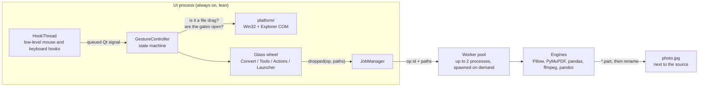

<div align="center">

# DragShift

Drag a file, tap a key, and drop it on a glass wheel to convert it.<br>
A free, open-source Windows take on Tangerine for Mac. Everything runs on your own machine.

[![Python 3.12][badge-python]][link-python]
[![PySide6][badge-qt]][link-qt]
[![uv][badge-uv]][link-uv]
[![Windows 10 | 11][badge-windows]][link-windows]
[![License: AGPL-3.0][badge-license]](LICENSE)


</div>

> [!NOTE]
> DragShift is in Sprint 1, working towards `v0.1.0`. The gesture, the glass wheel, Quick Launch and most converters work today. The Tools and Actions petals, toasts with Undo, and the tray and Settings window are still being built. [What works today](#what-works-today) has the details.

## About

Converting a file on Windows usually means opening an app or a website, uploading the file, picking a format, downloading the result and moving it back where it belongs. Online converters also send private files to servers you know nothing about.

Tangerine for Mac solved this with a gesture. You start dragging a file, tap a modifier key, and a radial wheel opens around the cursor. You drop the file on a petal, and the new file appears next to the original. DragShift brings that gesture to Windows as a lightweight background app written in Python and Qt. It also adds **Quick Launch**: tap Shift or Ctrl on an empty desktop to open a wheel of your favourite apps or websites.

DragShift is a clean-room re-implementation. It copies no code or assets from Tangerine.

## How it works


| You do this | You get |
|---|---|
| Drag a file and tap **Shift** | The **Convert** wheel: PNG, JPG, WEBP, PDF, MP4, MP3, CSV, ZIP… |
| Drag a file and tap **Ctrl** | The **Tools** wheel: compress with size presets, crop, add a background, resize, rotate… |
| Drag a file and tap **Alt** | The **Actions** wheel: copy path, open a terminal here, copy or move to a pinned folder, zip… |
| Tap **Shift** on an empty desktop | **Quick Launch**: up to 8 of your apps |
| Tap **Ctrl** on an empty desktop | **Quick Launch**: up to 8 of your websites |

While a wheel is open you can tap a different key to swap wheels. Press **Esc**, or drop anywhere outside a petal, and nothing happens. The output is written next to the source, as `photo.jpg` for a convert or `clip Compressed.mp4` for a tool, and an existing file is never overwritten: a clash becomes `photo (2).jpg`.

<!--
Demo GIFs (DS-30). Record them with ScreenToGif at 1280x720 or smaller, keep each under 5 MB,
save them in docs/media/ and replace this comment with:

<table>
  <tr>
    <td align="center"><br><sub>Convert a photo</sub></td>
    <td align="center"><br><sub>Swap wheels mid-drag</sub></td>
  </tr>
  <tr>
    <td align="center"><br><sub>Quick Launch</sub></td>
    <td align="center"><br><sub>Compress for Discord</sub></td>
  </tr>
</table>
-->

### Quick Launch


A **tap** is a key going down and up within 300 ms with nothing else pressed in between. Holding Shift to type a capital letter is not a tap. Before a Quick Launch wheel opens, every one of these checks must pass, or nothing happens:

- The desktop or an Explorer window is in front.
- No full-screen game, presentation or "busy" state is running.
- The focus is not in a text box, so renaming a file does not trigger it.
- Nothing is selected on the desktop or in that Explorer window.
- The app in front is not on your blocklist.
- Gestures are not paused.

If single taps still trigger by accident, switch `keys.tap_mode` to `"double"` in the config.

## What works today

| Feature | Status | Story |
|---|---|---|
| Drag + Shift/Ctrl/Alt opens a wheel; swap, Esc, 30 s timeout | ✅ Done | DS-10, DS-11 |
| Glass wheel with light and dark mode, the Windows accent colour and reduced motion | ✅ Done | DS-9, DS-12 |
| Convert: images, audio, video, spreadsheets, subtitles, archives, folders | ✅ Done | DS-13, DS-14, DS-20 |
| Quick Launch: tap detection, context checks, Apps and Sites wheels | ✅ Done | DS-15, DS-19 |
| Single instance, `--background`, log file, autostart, command line | ✅ Done | DS-26 |
| Convert: PDF and documents (DOCX, Markdown, HTML, EPUB…) | 🚧 In progress | DS-16, DS-17 |
| Toasts with Open / Show / Undo, job history, smart petal order | 🚧 In progress | DS-18 |
| Tools wheel: compress with size presets, resize, rotate, PDF merge and split… | 🚧 In progress | DS-22, DS-23 |
| Actions wheel: copy path, terminal here, copy/move to pinned folders, SHA-256 | 🚧 In progress | DS-21 |
| Crop and Add BG dialogs | 🚧 In progress | DS-24, DS-27, DS-28 |
| Tray icon and Settings window | 🚧 In progress | DS-25 |

### Conversions

These are the Convert-wheel targets that are built. A target in the same format as the file is hidden, so a PNG has no "PNG" petal.

| Input | Targets | Engine |
|---|---|---|
| **Image**: jpg png webp heic avif tiff bmp gif ico, svg (input only) | JPG PNG WEBP HEIC AVIF PDF TIFF BMP ICO | Pillow, pillow-heif |
| **Several images** | Merge to PDF | Pillow |
| **Audio**: mp3 m4a wav flac ogg opus aiff wma aac | MP3 M4A WAV FLAC OGG OPUS AIFF | ffmpeg |
| **Video**: mp4 mov mkv webm avi wmv m4v | MP4 MOV MKV WEBM GIF MP3 AVI | ffmpeg |
| **Spreadsheet**: xlsx xls ods csv tsv | XLSX CSV TSV ODS | pandas, openpyxl, odfpy, xlrd |
| **Subtitle**: srt vtt ass ssa | SRT VTT ASS TXT | pysubs2 |
| **Archive**: zip tar gz tgz rar 7z | Extract here, ZIP, TAR.GZ | `zipfile`, `tarfile`, Windows `tar.exe` |
| **Folder** | ZIP | `zipfile` |

The full plan, including PDF, documents and every tool, is in [PRD §6](docs/PRD.md#6-conversion--tool-matrix).

## Getting started

### Requirements

- Windows 11 (23H2 or newer) or Windows 10 22H2, x64.
- [uv](https://docs.astral.sh/uv/getting-started/installation/). It installs Python 3.12 for you if you don't have it.
- Git.

You don't need ffmpeg or pandoc. They come bundled through `imageio-ffmpeg` and `pypandoc-binary`. If ffmpeg is already on your `PATH`, DragShift uses that one.

### Install

```powershell
git clone https://github.com/RudraSomaiya/DragShift.git
cd DragShift
uv sync
```

### Run

```powershell
uv run dragshift                 # in this console, with logs; Ctrl+C quits
uv run dragshift --background    # detached, with no console window
```

Then drag any file from the desktop or Explorer and tap **Shift**. Only one copy runs at a time. Starting a second one hands over to the first and exits.

Until the tray icon arrives (DS-25), stop a background copy from PowerShell:

```powershell
Get-CimInstance Win32_Process -Filter "Name='pythonw.exe'" |
  Where-Object CommandLine -like '*dragshift*' |
  Invoke-CimMethod -MethodName Terminate
```

### Start with Windows

Set `"autostart": true` under `general` in the config file and restart DragShift. It adds `DragShift` to `HKCU\Software\Microsoft\Windows\CurrentVersion\Run`, pointing at the project's own `pythonw.exe`. Set it back to `false` to remove the entry.

## Configuration

DragShift keeps everything in two places:

| What | Where |
|---|---|
| Settings | `%APPDATA%\DragShift\config.json` |
| Site icons (fetched once per site) | `%APPDATA%\DragShift\icons\` |
| Logs (1 MB × 3, rotating) | `%LOCALAPPDATA%\DragShift\logs\dragshift.log` |

The file is created with defaults on the first run. Until the Settings window lands, edit it by hand and restart DragShift. If the file is broken, DragShift saves it as `config.bad.json` and starts with defaults, so a typo never stops the app.

A Quick Launch setup looks like this:

```json
{
  "version": 1,
  "keys": { "convert": "shift", "tools": "ctrl", "actions": "alt",
            "launch_apps": "shift", "launch_sites": "ctrl", "tap_mode": "single" },
  "launcher": {
    "enabled": true,
    "apps": [
      { "label": "VS Code",   "target": "shell:AppsFolder\\Microsoft.VisualStudioCode" },
      { "label": "Terminal",  "target": "Microsoft.WindowsTerminal_8wekyb3d8bbwe!App" },
      { "label": "",          "target": "C:\\Windows\\notepad.exe" },
      { "label": "Downloads", "target": "%USERPROFILE%\\Downloads" }
    ],
    "sites": [
      { "label": "GitHub",  "url": "github.com" },
      { "label": "YouTube", "url": "youtube.com" }
    ]
  },
  "appearance": { "theme": "system", "accent": "system", "reduced_motion": "system" },
  "general": { "autostart": false, "paused": false, "blocklist": [] }
}
```

- An app `target` can be an `.exe`, an `.lnk` shortcut, a folder, or a Store app ID. To find a Store app's ID, run `Get-StartApps` in PowerShell. Leave `label` empty to use the app's own name.
- `theme` is `system`, `light` or `dark`. `accent` is `system` or a colour like `"#4C8DFF"`.
- `blocklist` takes process names, such as `"code.exe"`, where Quick Launch should never open.
- Every key and its default is in [PRD §10.1](docs/PRD.md#101-appdatadragshiftconfigjson-schema-v1).

## Command line

The same operations run headless, which is handy for scripts and tests:

```powershell
uv run dragshift ops photo.png                       # list what the wheels would offer
uv run dragshift convert photo.png --to jpg          # writes photo.jpg next to it
uv run dragshift convert a.jpg b.jpg --to "merge to pdf"
uv run dragshift tool tools.video.compress clip.mp4 --preset discord   # once DS-22 lands
```

Output paths are printed one per line. The exit code is `0` on success, `1` if the operation failed, and `2` for bad usage. For example, `ops` on a PNG prints:

```
convert:
  convert.image.jpg            JPG
  convert.image.webp           WEBP
  convert.image.heic           HEIC
  convert.image.avif           AVIF
  convert.image.pdf            PDF
  convert.image.tiff           TIFF
  convert.image.bmp            BMP
  convert.image.ico            ICO
```

## Your files are safe


DragShift never changes, moves or deletes the file you drag:

- **Copy, never move.** When you hold Shift during a drag, Explorer treats the drop as a *move* and deletes the source if the target agrees. DragShift's wheel only ever reports a *copy*, and over the hub, a gap or outside the wheel it refuses the drop.
- **No half-written files.** Every output is written to a `.part` file first and renamed only when the job succeeds. Cancelling a job deletes the partial file.
- **Nothing is overwritten.** A name clash gets ` (2)`, ` (3)` and so on.
- **Offline.** The only network request DragShift makes is fetching a site's favicon once, when you add it to Quick Launch. There is no telemetry, no account and no auto-update.

## How it's built


DragShift runs as one small, always-on UI process. Heavy libraries such as Pillow, PyMuPDF and pandas are never loaded in it. When you drop a file, a short-lived worker process does the conversion and quits after 60 seconds with no work, so an idle DragShift has no workers at all.



The hook callbacks do almost nothing: they push the event to the Qt thread and pass it on to Windows, so DragShift never slows down or swallows your input. The glass look is a blurred snapshot of the screen behind the wheel, rendered once per opening with QPainter.

[`docs/architecture.md`](docs/architecture.md) covers the gesture state machine, the drop handshake with Explorer, the glass recipe and how to add a new operation.

## Project layout

```
DragShift/
├── src/dragshift/
│   ├── __main__.py          CLI entry point: run, --background, ops, convert, tool
│   ├── app.py               Wires hooks, gesture, wheels and jobs together
│   ├── gesture.py           The gesture state machine
│   ├── config.py            config.json schema, load, save and migrate
│   ├── platform/            Win32: hooks, drag detection, Explorer COM, DWM, autostart
│   ├── ui/                  Glass wheel, launcher wheel, theme and geometry
│   ├── engine/              Kinds, Op registry, job manager, worker, converters
│   └── launcher/            Quick Launch apps, sites and favicon cache
├── tests/                   pytest and pytest-qt; fixtures are generated at test time
├── spikes/                  Day-1 prototypes for hooks and the glass wheel
├── docs/
│   ├── PRD.md               The spec, and the source of truth
│   ├── architecture.md      How the pieces fit together
│   └── manual-test-checklist.md
├── CLAUDE.md                Rules for Claude Code agents working in this repo
└── pyproject.toml
```

## Development

```powershell
uv sync                                   # includes the dev tools
uv run pytest -q                          # tests
uv run ruff check . ; uv run ruff format .
```

CI runs ruff and pytest on `windows-latest` for every pull request. A test checks that the UI process never imports Pillow, PyMuPDF, pandas, numpy, pdf2docx or pypandoc.

The project follows a one-week Scrum sprint with Jira (project key `DS`). `main` is protected: every change is a pull request from a `<type>/DS-<n>-<slug>` branch, with Conventional Commit messages such as `feat(engine): add HEIC to JPG [DS-13]`, one approval and a green CI run. Read [`docs/PRD.md`](docs/PRD.md) before changing behaviour, and tick the items you touched in [`docs/manual-test-checklist.md`](docs/manual-test-checklist.md) in your PR. Both of us build with Claude Code, and [`CLAUDE.md`](CLAUDE.md) has the rules it follows here.

## Known limitations

- Windows only. There are no plans for macOS (use Tangerine) or Linux.
- There is no installer or `.exe` yet. You run it from a clone with `uv`.
- Only real files and folders work. Text, images dragged from a browser, and Outlook attachments without a path show "Unsupported".
- If the window you drag from runs as administrator, Windows blocks the drop into a normal-user app (UIPI). DragShift does not try to work around this.
- Office → PDF needs Microsoft Office or LibreOffice and is a stretch goal for `v0.1.0`.

## Credits

The gesture comes from [Tangerine for Mac](https://tangerineformac.com/). DragShift stands on [Qt for Python](https://doc.qt.io/qtforpython-6/), [Pillow](https://python-pillow.org/), [PyMuPDF](https://pymupdf.readthedocs.io/), [pandoc](https://pandoc.org/), [FFmpeg](https://ffmpeg.org/) and [pysubs2](https://github.com/tkarabela/pysubs2). The illustrations were made with the [Ian Xiaohei Illustrations](https://github.com/helloianneo/ian-xiaohei-illustrations) style.

## License

Released under the [GNU Affero General Public License v3.0](LICENSE). PyMuPDF is AGPL-licensed, so DragShift is too.

## Authors

Made by Rudra Somaiya and Preeyas Tumulu.

| | |
|---|---|
| **Rudra Somaiya**<br><sub>Platform: hooks, gesture, Explorer, Quick Launch, app shell</sub> | [![GitHub][badge-github-rudra]][link-github-rudra] [![LinkedIn][badge-linkedin-rudra]][link-linkedin-rudra] |
| **Preeyas Tumulu**<br><sub>UI and engine: glass wheel, theme, registry, converters</sub> | [![GitHub][badge-github-preeyas]][link-github-preeyas] [![LinkedIn][badge-linkedin-preeyas]][link-linkedin-preeyas] |

[badge-python]: https://img.shields.io/badge/Python-3.12-3776AB?style=for-the-badge&logo=python&logoColor=white
[badge-qt]: https://img.shields.io/badge/PySide6-Qt_Widgets-41CD52?style=for-the-badge&logo=qt&logoColor=white
[badge-uv]: https://img.shields.io/badge/uv-DE5FE9?style=for-the-badge&logo=uv&logoColor=white
[badge-windows]: https://img.shields.io/badge/Windows-10_|_11-0078D4?style=for-the-badge&logo=windows11&logoColor=white
[badge-license]: https://img.shields.io/badge/License-AGPL--3.0-A42E2B?style=for-the-badge
[badge-github-rudra]: https://img.shields.io/badge/GitHub-RudraSomaiya-181717?style=for-the-badge&logo=github&logoColor=white
[badge-linkedin-rudra]: https://img.shields.io/badge/LinkedIn-Rudra_Somaiya-0A66C2?style=for-the-badge&logo=data:image/svg%2bxml;base64,PHN2ZyB4bWxucz0iaHR0cDovL3d3dy53My5vcmcvMjAwMC9zdmciIHZpZXdCb3g9IjAgMCAyNCAyNCI+PHBhdGggZmlsbD0iI2ZmZiIgZD0iTTIwLjQ1IDIwLjQ1aC0zLjU2di01LjU3YzAtMS4zMy0uMDItMy4wNC0xLjg1LTMuMDQtMS44NSAwLTIuMTQgMS40NS0yLjE0IDIuOTR2NS42N0g5LjM1VjloMy40MXYxLjU2aC4wNWMuNDgtLjkgMS42NC0xLjg1IDMuMzctMS44NSAzLjYgMCA0LjI3IDIuMzcgNC4yNyA1LjQ2djYuMjh6TTUuMzQgNy40M2EyLjA2IDIuMDYgMCAxIDEgMC00LjEyIDIuMDYgMi4wNiAwIDAgMSAwIDQuMTJ6TTcuMTIgMjAuNDVIMy41NlY5aDMuNTZ2MTEuNDV6TTIyLjIyIDBIMS43N0MuNzkgMCAwIC43NyAwIDEuNzN2MjAuNTRDMCAyMy4yMy43OSAyNCAxLjc3IDI0aDIwLjQ1Yy45OCAwIDEuNzgtLjc3IDEuNzgtMS43M1YxLjczQzI0IC43NyAyMy4yIDAgMjIuMjIgMHoiLz48L3N2Zz4=
[badge-github-preeyas]: https://img.shields.io/badge/GitHub-PreeyasTumulu-181717?style=for-the-badge&logo=github&logoColor=white
[badge-linkedin-preeyas]: https://img.shields.io/badge/LinkedIn-Preeyas_Tumulu-0A66C2?style=for-the-badge&logo=data:image/svg%2bxml;base64,PHN2ZyB4bWxucz0iaHR0cDovL3d3dy53My5vcmcvMjAwMC9zdmciIHZpZXdCb3g9IjAgMCAyNCAyNCI+PHBhdGggZmlsbD0iI2ZmZiIgZD0iTTIwLjQ1IDIwLjQ1aC0zLjU2di01LjU3YzAtMS4zMy0uMDItMy4wNC0xLjg1LTMuMDQtMS44NSAwLTIuMTQgMS40NS0yLjE0IDIuOTR2NS42N0g5LjM1VjloMy40MXYxLjU2aC4wNWMuNDgtLjkgMS42NC0xLjg1IDMuMzctMS44NSAzLjYgMCA0LjI3IDIuMzcgNC4yNyA1LjQ2djYuMjh6TTUuMzQgNy40M2EyLjA2IDIuMDYgMCAxIDEgMC00LjEyIDIuMDYgMi4wNiAwIDAgMSAwIDQuMTJ6TTcuMTIgMjAuNDVIMy41NlY5aDMuNTZ2MTEuNDV6TTIyLjIyIDBIMS43N0MuNzkgMCAwIC43NyAwIDEuNzN2MjAuNTRDMCAyMy4yMy43OSAyNCAxLjc3IDI0aDIwLjQ1Yy45OCAwIDEuNzgtLjc3IDEuNzgtMS43M1YxLjczQzI0IC43NyAyMy4yIDAgMjIuMjIgMHoiLz48L3N2Zz4=
[link-python]: https://www.python.org
[link-qt]: https://doc.qt.io/qtforpython-6/
[link-uv]: https://docs.astral.sh/uv/
[link-windows]: https://www.microsoft.com/windows
[link-github-rudra]: https://github.com/RudraSomaiya
[link-linkedin-rudra]: https://www.linkedin.com/in/rudra-somaiya/
[link-github-preeyas]: https://github.com/PreeyasTumulu
[link-linkedin-preeyas]: https://www.linkedin.com/in/preeyas-tumulu/
