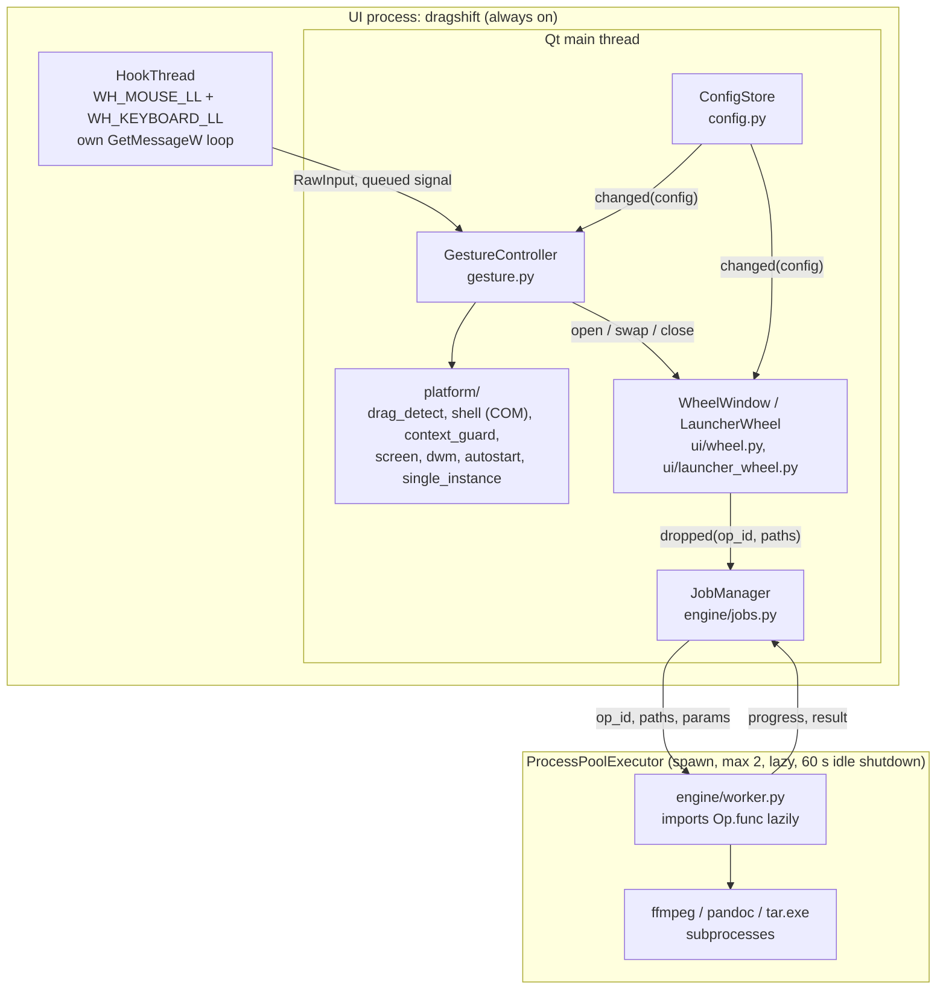
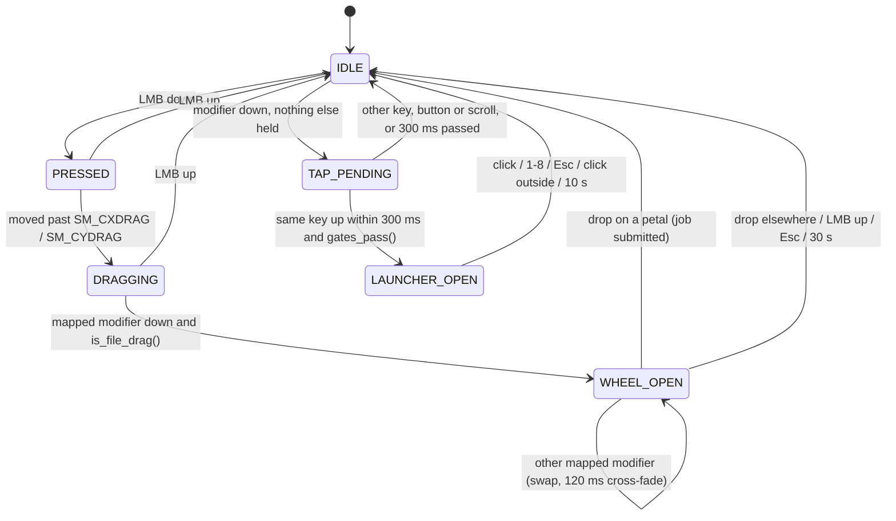
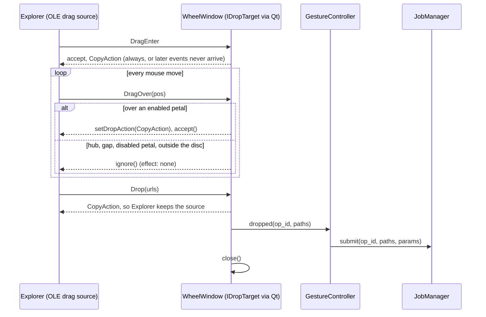

# DragShift architecture

This page explains how DragShift is put together and why. [`PRD.md`](PRD.md) is the spec and wins if the two disagree. Section numbers below (§9.2, FR-1.8, …) point into it.

## The two-process model

DragShift is always running, so it must cost almost nothing while idle (NFR-1: at most 60 MB private memory, no workers). It is split in two:

- **The UI process** is always on. It runs the input hooks, the gesture state machine, the wheels and the job manager. It imports Qt, pywin32 and the standard library, and nothing heavy.
- **Worker processes** do the conversions. They are spawned the first time a job is submitted, at most two at once, and shut down after 60 seconds with no jobs. A worker imports an engine (Pillow, PyMuPDF, pandas…) only when an Op needs it. ffmpeg, pandoc and `tar.exe` run as subprocesses of a worker.



Two rules keep this split honest:

- **Lean imports (CLAUDE.md rule 2).** `ui/`, `platform/`, `gesture.py` and `app.py` never import Pillow, fitz, pandas, numpy, pdf2docx or pypandoc. Converter modules are imported by the UI process to register their Ops, so they import their engine *inside* the worker function. `tests/ui/test_ui_lean_imports.py` and `tests/engine/test_lean_imports.py` start the app in a subprocess and fail if any of those modules is loaded.
- **Ops are referenced by dotted path.** `Op.func` is a string such as `dragshift.engine.converters.images:to_png`. The UI process never calls it; the worker imports and runs it.

Qt uses the GDI font engine (`-platform windows:fontengine=gdi`). DirectWrite's font database alone cost about 28 MB of private memory in the DS-5 spike.

## Input hooks

`platform/hooks.py` installs low-level mouse and keyboard hooks (`WH_MOUSE_LL = 14`, `WH_KEYBOARD_LL = 13`) on a dedicated thread with its own `GetMessageW` loop.

Windows silently removes a low-level hook whose callback is too slow, so the callbacks do O(1) work (NFR-3, CLAUDE.md rule 3):

1. Copy the event into a small tuple.
2. Emit a queued Qt signal.
3. Return `CallNextHookEx`.

There is no COM, I/O or logging inside a callback, and no event is ever swallowed. Injected events (`LLMHF_INJECTED`) are ignored. A 5-second watchdog re-installs the hooks if Windows removed them.

## The gesture state machine

`gesture.py` turns the raw event stream into wheel opens. It runs on the Qt thread, so it may call COM and check windows; the hook thread never does.



**`is_file_drag()` (FR-1.2).** A modifier during a mouse drag only opens a wheel if this is a real file drag. Either a visible `SysDragImage` window exists (the shell's drag image), or the root window under the cursor at LMB-down was Explorer or the desktop (`CabinetWClass`, `Progman`, `WorkerW`). A modifier already held before the drag started does not count.

**Pre-fill (FR-1.5).** Windows only sends `DragEnter` after the next mouse move, so the wheel would open empty for a moment. To avoid that, `platform/shell.py` reads the Explorer selection through Shell COM (`Shell.Application.Windows()`, or `FindWindowSW` for the desktop) and the wheel draws its petals from it at once. The paths in the real drop event are authoritative. If they differ, the wheel re-renders.

**Quick Launch gates (FR-3.2).** `platform/context_guard.py` runs these checks on the Qt thread after a tap, and every one must pass:

| Gate | Check |
|---|---|
| G-a | The foreground root window is `Progman`, `WorkerW` or `CabinetWClass` |
| G-b | `SHQueryUserNotificationState` is not full-screen D3D, presentation mode or busy |
| G-c | The focused control (`GetGUIThreadInfo().hwndFocus`) is not an `Edit`, `RichEdit*` or XAML text input |
| G-d | Nothing is selected in that Explorer view or on the desktop |
| G-e | The foreground process is not on the blocklist |
| G-f | Gestures are not paused |

## The drop handshake

This is the part that can lose a user's file, so it gets its own section (FR-1.8, M3).

When you drag with Shift held, Explorer asks the drop target for a *move*. If the target agrees, Explorer deletes the source. The wheel therefore reports `CopyAction` and never `MoveAction`, and it refuses the drop anywhere that isn't an enabled petal. `acceptProposedAction()` is banned because it would accept the move.



`dragEnterEvent` always accepts with `CopyAction`. The wheel opens with the cursor over the hub, and Windows only sends later events to a target that accepted the enter, so ignoring the first enter would leave the wheel dead. Qt follows the enter with a move at once, so the effect Explorer sees over the hub is still "none". This was checked against the window's real OLE `IDropTarget` in DS-9.

The wheel window never takes focus (`Qt.Tool | Qt.WindowDoesNotAcceptFocus`, `WA_ShowWithoutActivating`). Explorer has to stay active for the OLE drag to continue.

## The glass wheel

The look is "Frost": neutral frosted glass that takes its colour from what is behind it, with the Windows accent colour as the only strong colour (§8). Real-time blur would be expensive, but the desktop behind a wheel barely changes while it is open, so `ui/glass.py` renders the glass once per opening:

1. **Snapshot.** `BitBlt` the area behind the wheel with `SRCCOPY` and without `CAPTUREBLT`. Leaving out `CAPTUREBLT` excludes layered windows, so the drag image is not baked into the glass.
2. **Blur.** Scale down to 1/8 and back up, twice. This looks like a ~20 px Gaussian blur. Raise saturation ×1.3.
3. **Refraction rim.** In the outer 18 px of the disc, draw the blurred snapshot magnified ×1.06 about the centre, for a curved-glass lensing effect.
4. **Tint, highlight and shadow** from the theme tokens in `ui/theme.py`.
5. **Cache** the result as a `QPixmap`. Hover and animation layers paint on top of it.

`ui/wheel_geometry.py` holds the pure maths (petal angles, annular sectors, hit-testing) and `ui/wheel_model.py` turns Ops into petals, including the More… ring when there are more than 8. Both are tested without a window. Light or dark mode comes from `AppsUseLightTheme`, and the accent comes from `HKCU\Software\Microsoft\Windows\DWM\AccentColor`, with `DwmGetColorizationColor` as the fallback.

## Ops and jobs

Every conversion, tool and action is an **Op** (§9.4), declared next to its worker function with `@op`:

```python
@op(id="convert.subtitle.vtt", wheel="convert", label="VTT", kinds=SUBTITLE, hide_if_same_ext="vtt")
def to_vtt(paths: list[Path], params: dict, ctx: "JobContext") -> list[Path]:
    return _convert(paths, ctx, "vtt")
```

`registry.ops_for(paths, wheel)` returns the Ops valid for **all** the dragged files (FR-1.11), drops unavailable ones (FR-2.4), and keeps the declaration order as the default petal order.

`JobManager.submit()` sends the Op id, paths and params to the worker pool. Inside the worker, `JobContext.output_path()` picks the output name and returns a `*.part` path:

- Converts are named `<stem>.<ext>` and tools `<stem> <Label>.<ext>` (FR-5.1).
- A name clash gets ` (2)`, ` (3)`, … (FR-5.2).
- If the source folder is not writable, the output goes to Downloads (FR-5.3).

When the worker returns, JobManager renames each `.part` to its final name, never over an existing file. On failure or cancel, the `.part` files are deleted. Cancel flags are empty files under `%LOCALAPPDATA%\DragShift\cancel\` that `ctx.cancelled()` checks, and a cancelled ffmpeg run is killed at once (`TerminateProcess`).

### Adding an Op

1. Pick the module under `engine/converters/` (or create one; every module in the package is imported automatically).
2. Write `def fn(paths, params, ctx) -> list[Path]`. Import the engine library inside the function, and write only to paths from `ctx.output_path()`.
3. Decorate it with `@op(...)`, using an id of the form `<wheel>.<kind>.<name>`.
4. Add a round-trip test under `tests/engine/` that generates its fixture at test time and asserts the source bytes are unchanged.
5. Check it with `uv run dragshift ops <file>` and `uv run dragshift convert <file> --to <label>`.

## App shell

- **Single instance (FR-6.3).** A named mutex, `Local\DragShift.SingleInstance`. A second launch signals an auto-reset event that the first instance waits on, then exits.
- **Background (FR-6.2).** `--background` relaunches `pythonw.exe -m dragshift` with `DETACHED_PROCESS | CREATE_NEW_PROCESS_GROUP` and returns at once.
- **Logs (FR-6.5).** `%LOCALAPPDATA%\DragShift\logs\dragshift.log`, rotating at 1 MB × 3. There is no console handler under `pythonw`, which has no stderr.
- **Autostart (FR-7.2).** `config.general.autostart` is the source of truth. On start and on every config change, `platform/autostart.py` makes the `HKCU\…\Run\DragShift` value match it.
- **Config (§10.1).** `%APPDATA%\DragShift\config.json`, loaded into frozen dataclasses. Unknown keys are kept, a broken file is backed up to `config.bad.json`, and `ConfigStore.changed` tells the wheels to re-theme and reload the launcher.

## Testing

- **CI** (`windows-latest`): `ruff check`, `ruff format --check`, and `pytest -q` with `QT_QPA_PLATFORM=offscreen`.
- **Engine tests** generate their fixtures (Pillow images, an ffmpeg `lavfi` tone and clip, CSV/XLSX, SRT, ZIP) and hash the source before and after every Op.
- **UI tests** use pytest-qt for geometry, hit-testing, the More… ring, theme tokens and motion.
- **Gesture tests** feed synthetic event sequences to the state machine. No real hooks are installed.
- **A real drag-and-drop test** (`tests/test_real_dnd.py`) drives an actual OLE drag with Shift held to prove the source survives. It moves the real mouse, so it is off by default: set `DRAGSHIFT_REAL_DND=1` to run it.
- **The [manual checklist](manual-test-checklist.md)** covers what automation can't, such as multi-monitor scaling, full-screen games and reboots.
